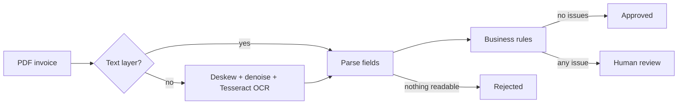
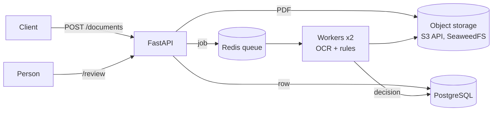

# InvoiceLens


Invoice intake pipeline: read a PDF (text layer or OCR), extract the fields, check them against
business rules, and decide **approve**, **review** or **reject**. Accuracy is measured against
ground truth on a synthetic dataset, so every claim below comes from `eval/report.md`.

Personal learning project, built on my own time with generated data only.

## Results (300 synthetic invoices, seed 42)

| Metric | Value |
| --- | ---: |
| All fields correct, clean PDFs | 100% (102/102) |
| All fields correct, scanned | 56% (61/109) |
| All fields correct, badly degraded scans | 15% (13/89) |
| Defective invoices caught (wrong total, wrong VAT, unknown vendor, duplicate) | 95% (74/78) |
| Approval precision (approved and fully correct) | 84.5% (120/142) |

The rules are tuned to be conservative: when OCR is unsure, the invoice goes to a person.
Full breakdown by template and field: [eval/report.md](eval/report.md).
How OCR preprocessing was chosen: [ADR 0002](docs/adr/0002-ocr-preprocessing.md).

## How it works



- **Extraction** (`app/extraction`): labelled regex and line parsing for vendor, invoice number,
  date, currency, subtotal, VAT, total and line items, in English and Serbian formats
  (`1,234.50` and `1.234,50`). Each field has a confidence score.
- **Validation** (`app/validation/rules.py`): line items sum to the subtotal, VAT matches the rate,
  subtotal + VAT = total, vendor is known (fuzzy match for OCR typos), date in range, no duplicates.
- **Synthetic data** (`tools/synth`): four invoice layouts, three scan quality levels, and injected
  defects with the expected decision stored next to each file.
- **Evaluation** (`eval/run_eval.py`): field accuracy by noise level and template, decision
  agreement, defect detection and the reasons behind false alarms.

## Run it

Requires Python 3.11+ and Tesseract (`sudo apt install tesseract-ocr`). On Windows, use WSL2.

```bash
make install && source .venv/bin/activate
make lint      # ruff + mypy
make test      # unit + end-to-end tests
make demo      # generate 300 invoices and write eval/report.md
```

## Run it as a service

The same pipeline runs behind an API, with a job queue, workers and a review page.



Requires Docker (Docker Desktop with WSL integration works).

```bash
make up        # builds the image and starts api, 2 workers, postgres, redis, storage
make data      # generate invoices (once)
make load      # upload 50 invoices and compare decisions with ground truth
make logs      # JSON logs from api and workers
make down
```

- API docs: http://localhost:8000/docs
- Review queue: http://localhost:8000/review
- Health and metrics: `/healthz`, `/metrics` (Prometheus format)

Run a published release instead of a local build:

```bash
IMAGE=ghcr.io/ziksona1312/invoicelens:latest docker compose up -d --no-build
```

Design: [ADR 0003](docs/adr/0003-service-architecture.md) (idempotent uploads, duplicate
detection across workers, retries and a dead-letter queue) and
[ADR 0004](docs/adr/0004-object-storage-seaweedfs.md) (why SeaweedFS instead of MinIO).

## Roadmap

- [x] Core: generator, extraction, validation, evaluation, CI
- [x] Service: FastAPI + Redis/RQ workers + PostgreSQL + S3 storage, review queue
- [x] CI/CD: images on GHCR with SBOM, Trivy gate, SHA-pinned actions, Dependabot, protected `main`
- [ ] Ansible: provision an Ubuntu VM (hardening, Docker, backups), Molecule tests
- [ ] Terraform: deploy the stack (dev/staging), plan on pull requests
- [ ] Monitoring (Prometheus + Grafana) and a measured backup restore
- [ ] Optional: LLM fallback for low-confidence fields, compared on the same report

## Decisions

- [ADR 0001: Rules first, measured against ground truth](docs/adr/0001-rules-before-ml.md)
- [ADR 0002: OCR preprocessing](docs/adr/0002-ocr-preprocessing.md)
- [ADR 0003: Service architecture](docs/adr/0003-service-architecture.md)
- [ADR 0004: SeaweedFS instead of MinIO](docs/adr/0004-object-storage-seaweedfs.md)
- [ADR 0005: CI/CD and supply-chain security](docs/adr/0005-ci-cd-and-supply-chain.md)
